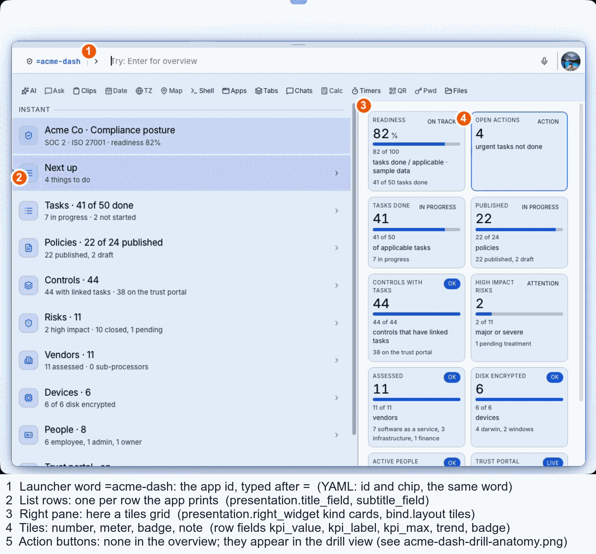
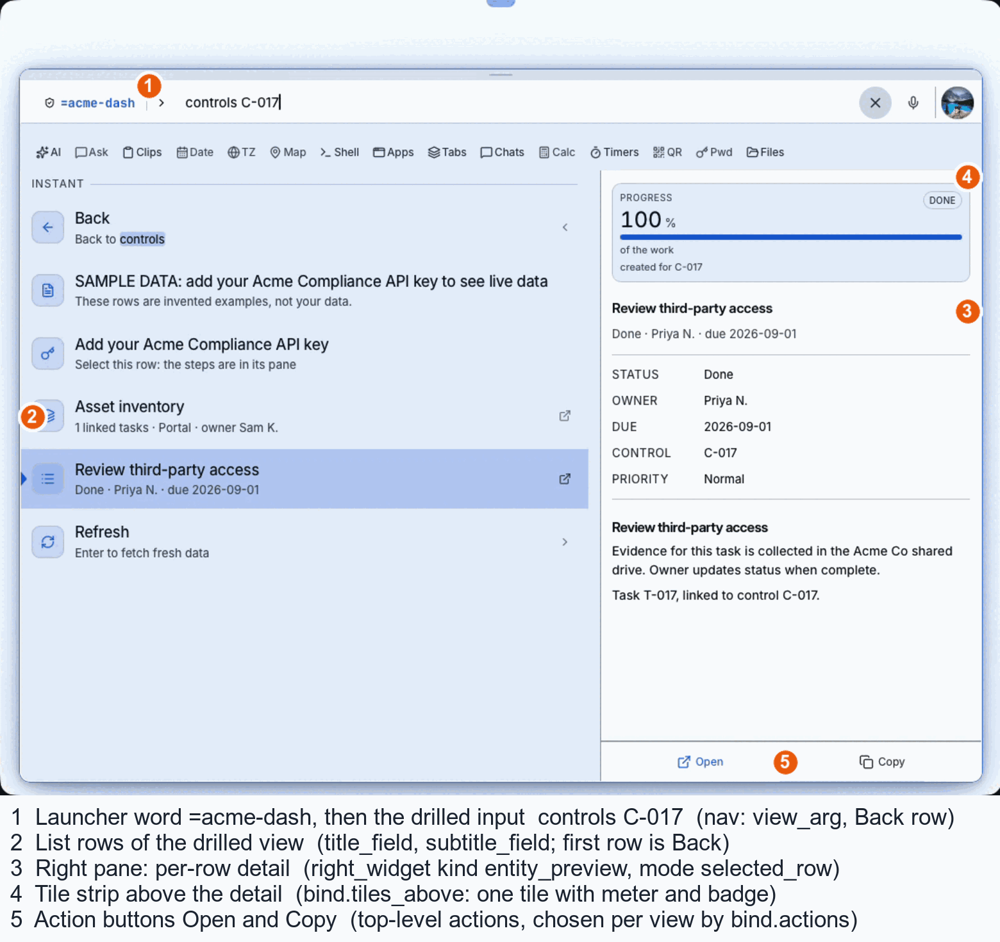
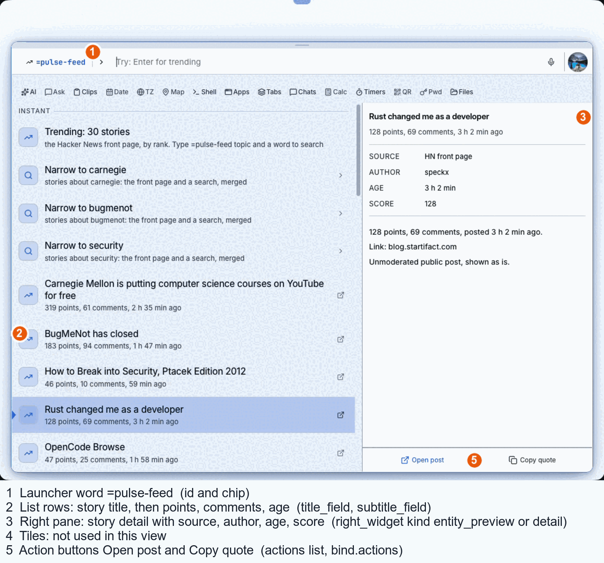
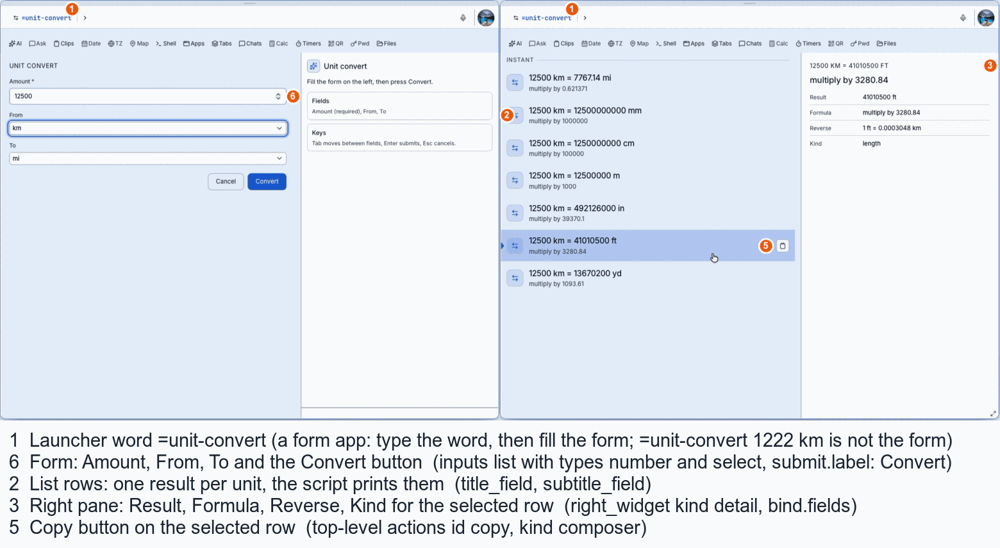

# Anatomy of a Bolt App

What you see in the launcher, and the exact key that draws it. Each picture has numbered call-outs; each number maps to a key in the example's YAML (`kit/examples/<id>/utilities/<id>.yaml`) and to a row in [`kit/examples/capabilities.json`](../kit/examples/capabilities.json) (table form: [`CAPABILITIES.md`](../kit/examples/CAPABILITIES.md)). Snippets are copied from the example files; elided lines are shown as `# ...`. The test `toolkit/test/docs-images.test.mjs` checks every quoted line against the file.

Numbers: 1 launcher word, 2 list rows, 3 right pane, 4 tiles, 5 action buttons, 6 form (unit-convert only).

More pictures and the example for each: [gallery](gallery.md). Also on the site: [Anatomy of an app](https://sparcle.app/docs/extend/anatomy).

## acme-dash: overview

Example: [`kit/examples/acme-dash`](../kit/examples/acme-dash).



| # | What you see | Key that produces it | Capability row |
|---|---|---|---|
| 1 | `=acme-dash` after the `=` | top-level `id` and `chip`; the chip must equal the id | `platform.chip_equals_id` |
| 2 | List rows (Next up, Tasks, Policies) | `presentation.title_field`, `presentation.subtitle_field` | `layout.views` |
| 3 | The right pane is a grid of tiles | `presentation.right_widget.kind: cards`, `mode: list_data` | `widget.cards` |
| 4 | A tile: number, meter, badge, note | `bind.layout: "tiles"` and the row fields `kpi_label`, `kpi_value`, `kpi_unit`, `kpi_max`, `kpi_note`, `kpi_badge`, `kpi_foot` | `pane.tiles` |

Source: `kit/examples/acme-dash/utilities/acme-dash.yaml`

```yaml
id: acme-dash
chip: acme-dash
presentation:
  widget: list
  title_field: title
  subtitle_field: subtitle
  view_arg: view
  right_widget:
    kind: cards
    mode: list_data
    bind:
      layout: "tiles"
      title: "{{row.kpi_label}}"
      value: "{{row.kpi_value}}"
      max: "{{row.kpi_max}}"
      badge: "{{row.kpi_badge}}"
```

## acme-dash: drill

Type `controls C-017` after the chip. The first row is Back.



| # | What you see | Key that produces it | Capability row |
|---|---|---|---|
| 1 | `=acme-dash` plus the input `controls C-017` | `args` take `query.word(0)` as `view` and `query.word(1)` as `arg`; `presentation.view_arg: view` | `nav.binding`, `platform.chip_equals_id` |
| 2 | Rows of the drilled view; first row is Back | `title_field`, `subtitle_field`; the script prints the Back row | `nav.back`, `nav.children` |
| 3 | Per-row detail pane | `presentation.views.controls.right_widget.kind: entity_preview`, `mode: selected_row`, `bind.fields`, `bind.body` | `widget.entity_preview`, `pane.per_row` |
| 4 | One tile above the detail | `bind.tiles_above` inside the same `bind` | `pane.tiles` |
| 5 | Open and Copy buttons | top-level `actions` define them; `bind.actions` picks which ones show | `actions.footer` |

Source: `kit/examples/acme-dash/utilities/acme-dash.yaml`

```yaml
args:
  - { name: view, from: "query.word(0)", default: overview }
  - { name: arg, from: "query.word(1)", default: "-" }
    controls:
      right_widget:
        kind: entity_preview
        mode: selected_row
        bind:
          tiles_above:
            value: "{{row.kpi_value}}"
            max: "{{row.kpi_max}}"
          body: "{{row.body}}"
          actions:
            - "open"
            - "copy"
actions:
  - { id: open, kind: url, target: row, label: Open, url_template: "{{row.open_url}}" }
  - { id: copy, kind: composer, target: row, label: Copy, insert: "{{row.copy_text}}" }
```

`tiles_above` and `actions` sit inside `bind`. The `actions` definitions sit at the top level, and `bind.actions` only names which of them show.

## pulse-feed: story pane

Example: [`kit/examples/pulse-feed`](../kit/examples/pulse-feed). Each story gets its own pane. This view has no tiles.



| # | What you see | Key that produces it | Capability row |
|---|---|---|---|
| 1 | `=pulse-feed` | `id`, `chip` | `platform.chip_equals_id` |
| 2 | Story rows: title, then points, comments, age | `title_field`, `subtitle_field` (the script writes the subtitle text) | `nav.drill`, `search.searchable` |
| 3 | Story pane: source, author, age, score, body | `presentation.views.overview.right_widget.kind: entity_preview`, `bind.fields` reading the row fields story_source, story_author, story_age and story_score | `widget.entity_preview`, `pane.per_row` |
| 5 | Open post and Copy quote | top-level `actions` with these labels; `bind.actions` names them | `actions.footer` |

Source: `kit/examples/pulse-feed/utilities/pulse-feed.yaml`

```yaml
    overview:
      right_widget:
        kind: entity_preview
        mode: selected_row
        bind:
          fields:
            - { label: SOURCE, value: "{{row.story_source}}" }
            - { label: SCORE, value: "{{row.story_score}}" }
          body: "{{row.body}}"
          actions:
            - "open"
            - "copy"
actions:
  - { id: open, kind: url, target: row, label: "Open post", url_template: "{{row.open_url}}" }
  - { id: copy, kind: composer, target: row, label: "Copy quote", insert: "{{row.copy_text}}" }
```

## unit-convert: form, rows, detail

Example: [`kit/examples/unit-convert`](../kit/examples/unit-convert). Open `=unit-convert`, fill Amount, From and To, press Convert. Left: the form. Right: the result rows and the detail pane.



| # | What you see | Key that produces it | Capability row |
|---|---|---|---|
| 1 | `=unit-convert` | `id`, `chip` | `platform.chip_equals_id` |
| 6 | Amount, From, To and the Convert button | `inputs` (types `number` and `select`, `options`), `submit.label: "Convert"` | `inputs.form` |
| 2 | One row per unit ("12500 km = 7767.14 mi") | the script prints the rows; `title_field`, `subtitle_field` | `inputs.form` |
| 3 | Result, Formula, Reverse, Kind | `right_widget.kind: detail`, `mode: selected_row`, `bind.fields` | `widget.detail`, `pane.per_row` |
| 5 | Copy button on the selected row | top-level `actions` with `id: copy`; the Result field also has `copy: true` | `actions.row` |

Source: `kit/examples/unit-convert/utilities/unit-convert.yaml`

```yaml
inputs:
  - { name: "amount", type: "number", label: "Amount", required: true, placeholder: "12.5" }
submit:
  label: "Convert"
presentation:
  right_widget:
    kind: detail
    mode: selected_row
    bind:
      fields:
        - { label: "Result", value: "{{row.conv_result}}", copy: true }
        - { label: "Formula", value: "{{row.conv_formula}}" }
actions:
  - { id: copy, kind: composer, target: row, label: Copy, insert: "{{row.copy_text}}" }
```

The snippet shows the first input only; the file has two more inputs, From and To, of type `select` with the same shape.
