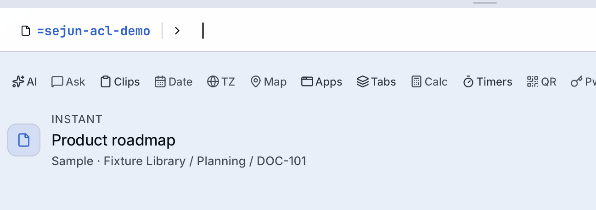
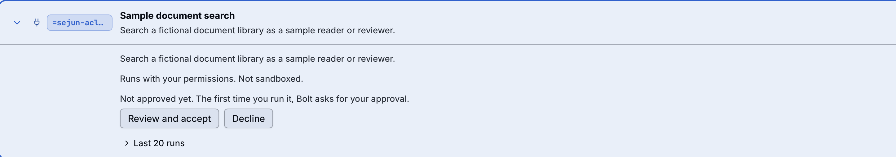

# Bolt notes from a first week of use

Everything here was run on Bolt 0.1.181 for macOS (arm64) on 2026-11-19. All data is
fictional. This folder lives only on this fork: it is a personal (tier 3) app, so it
does not belong in `apps/`.

## 1. A permission-aware search demo that runs in Bolt

[`sejun-acl-demo`](sejun-acl-demo) is a personal pack with a Python bridge over three
fictional documents. It checks each document's allow list **before** ranking:

| Same query `roadmap` | Result |
| --- | --- |
| `reader` | DOC-101 only. DOC-202 scores higher but is reviewer-only, so it never reaches the ranker |
| `reviewer` | DOC-202, then DOC-101 |
| Document with a missing or invalid ACL | Never ranked, never shown |
| Fixture missing or corrupt | One status row, zero document rows |

In Bolt, `=sejun-acl-demo` as `reader`:



```sh
python3 -m unittest discover -s personal-demos/tests -v   # 8 tests: ACL before top-k, grant, revoke, source failure
./bolt-apps lint personal-demos/sejun-acl-demo --personal
./bolt-apps check personal-demos/sejun-acl-demo
```

## 2. Settings keeps saying "Needs approval" after the app was approved

1. Install a personal pack with a bridge script (this one), drop it on Bolt, install.
2. Settings, Desktop App, User Apps, expand the row, Review and accept, click Accept.
3. `user-app-consent.json` now has `{"id": "sejun-acl-demo", "approved": true}`, and the
   launcher runs the app without asking again (screenshot above).
4. The Settings row still says **Needs approval / Not approved yet** with Review and
   accept and Decline, after closing and reopening Settings. Earlier the same row showed
   "Could not read this app's files." A transform added by hand (`csv2md`) shows
   **Approved** in the same list.



Issue: [SparcleHQ/sparcle.app#2](https://github.com/SparcleHQ/sparcle.app/issues/2).

So someone who has approved the app is told they have not, and is invited to approve
or decline it again. The launcher and the consent store agree; only the Settings view
disagrees, and only for the pack-installed bridge app.

Related: Accept refuses synthetic clicks (`user_util_consent_begin failed: Press Accept
with the mouse or keyboard`). That is a good guard, but an agent that drives Bolt
cannot tell whether approval failed or was never attempted. A visible message would help.

## 3. `bolt-apps check` fails every case on a Mac with pyenv

The Python finder picks `~/.pyenv/shims/python3`, a `#!/usr/bin/env bash` script.
`check` runs each case with a PATH that holds only its stubs, so the shim cannot find
`bash`: `kit/examples/unit-convert` fails 15 of 15 with exit 127, and the toolkit suite
fails 82 tests. The fix resolves a shim to the interpreter it runs, proven with an
empty PATH, and keeps the old behavior otherwise. After it, the toolkit suite passes
536, fails 0. Pull request: [SparcleHQ/bolt-apps#47](https://github.com/SparcleHQ/bolt-apps/pull/47).

## 4. Smaller findings

- The 38 connector samples published on sparcle.app all fail the public
  `schema/connector.schema.json` (fields such as `departments`, `dispatch`, `enabled`
  and the `entity_preview` widget are not in the schema). Pull request:
  [SparcleHQ/bolt-apps#48](https://github.com/SparcleHQ/bolt-apps/pull/48).
- In the launcher, pasting multiline CSV after selecting `=csv2md` opens the built-in
  table actions instead of the transform, so the example's own output is never shown.
  Issue: [SparcleHQ/sparcle.app#3](https://github.com/SparcleHQ/sparcle.app/issues/3).
- README install steps for a hand-added User App miss the Advanced toggle and the
  review step. Pull request: [SparcleHQ/bolt-apps#49](https://github.com/SparcleHQ/bolt-apps/pull/49).
